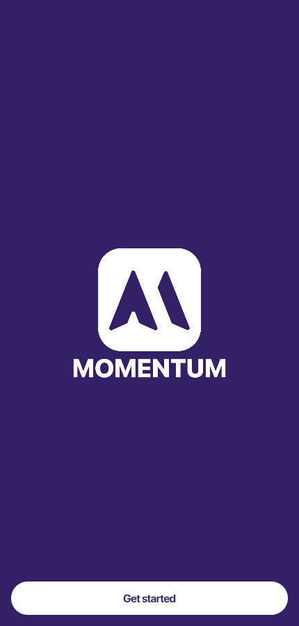
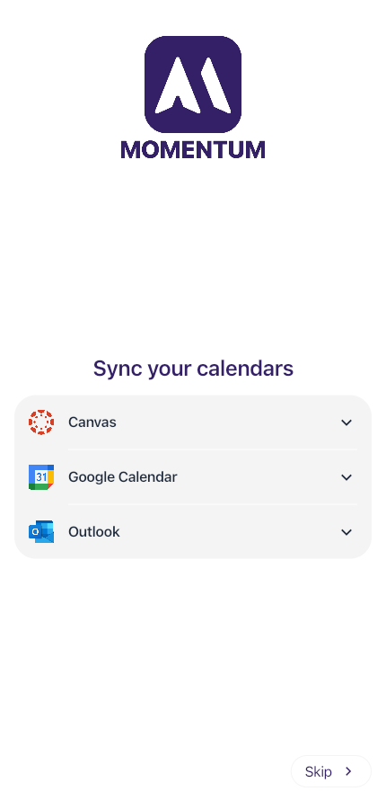
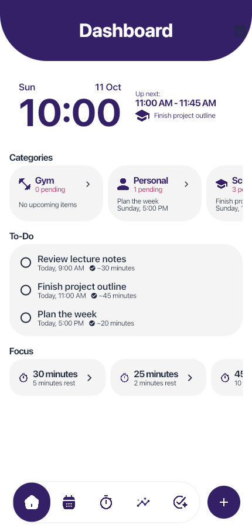
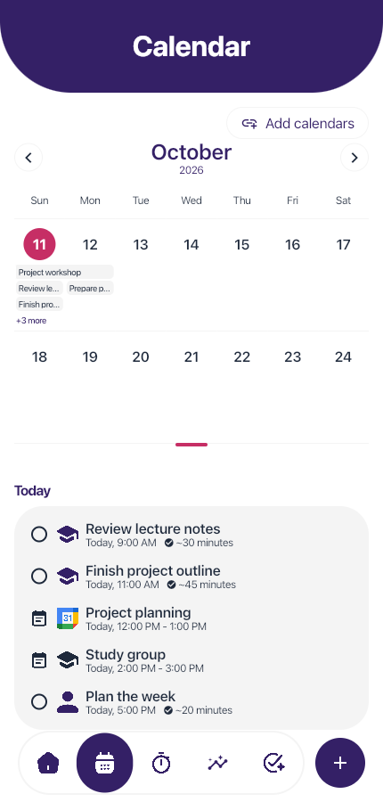
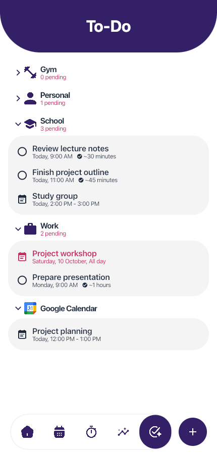
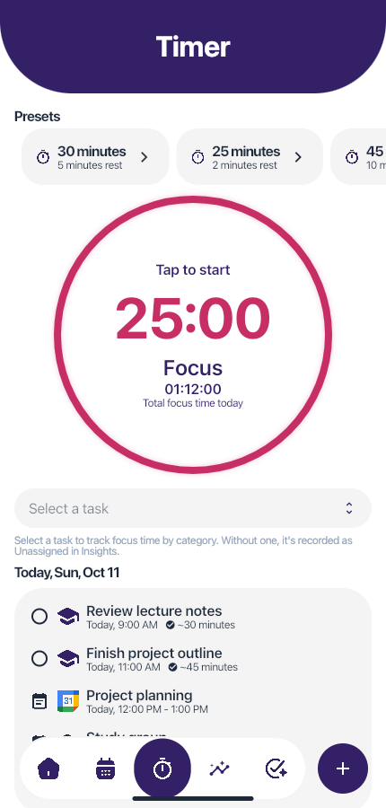
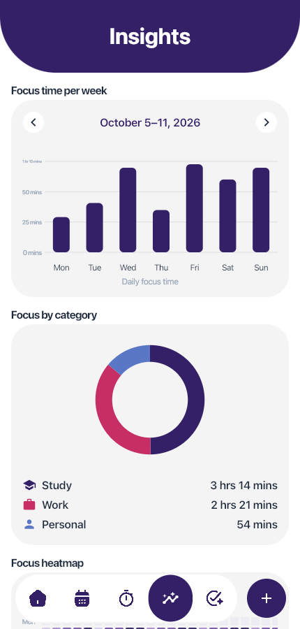
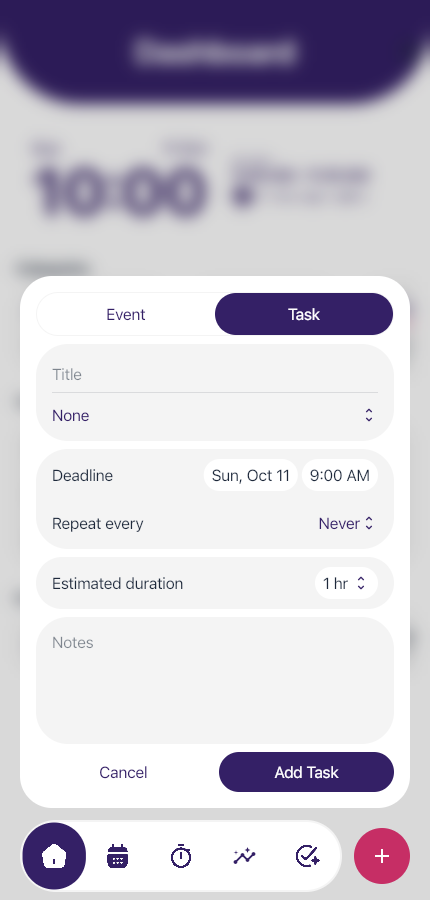
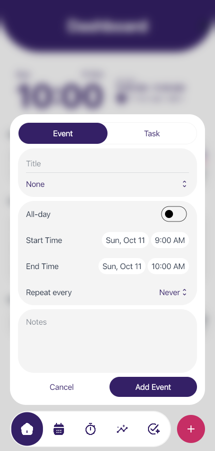

# Momentum

[](AI-USAGE.md)
[](AI-USAGE.md)

Momentum is a study-planning app that helps students organize tasks, events, focus sessions, and calendar imports in one place.

**Live demo:** [momentum-canvas.aerith-catap.workers.dev](https://momentum-canvas.aerith-catap.workers.dev)<br>
**Demo video:** [Watch the 4-minute, 32-second demo](https://drive.google.com/drive/folders/1MwIXI-WKYCeKETUISc-WlHO22oYcv9nz?usp=drive_link)<br>
**Repository:** [github.com/asm0git/momentum](https://github.com/asm0git/momentum)<br>
**Course:** Applications Development and Emerging Technologies (6ADET), Holy Angel University<br>
**Author:** Aerith Claude V. Catap

---

## Screenshots

| Welcome | Add calendars |
| --- | --- |
|  |  |

| Dashboard | Calendar | To-Do |
| --- | --- | --- |
|  |  |  |

| Timer | Insights |
| --- | --- |
|  |  |

| New task | New event |
| --- | --- |
|  |  |

## What it does

- Keep classes, deadlines, and personal plans together with tasks and events organized by category and schedule.
- See what is coming up in the calendar, with timed items in order and multi-day events shown across their dates.
- Start a focus session with the built-in Pomodoro timer.
- Review weekly focus totals and see how focus time is distributed across task categories.
- Import supported calendar items from Canvas, Google Calendar, and Outlook.

## Built with

| Part | Technology | What it does |
| --- | --- | --- |
| Framework | Flutter and Dart | Builds the web app. |
| App state | Provider | Shares planner state across screens. |
| Local storage | SQLite and IndexedDB | Saves planner data locally; the web build stores the database in browser IndexedDB. |
| Calendar backend | Cloudflare Workers and D1 | Fetches published calendar feeds and stores their encrypted links. |

## Running it yourself

### Use the hosted app

If you just want to use Momentum, open the [hosted app](https://momentum-canvas.aerith-catap.workers.dev). You do not need to download the project or install Flutter, Node.js, or Cloudflare tools. To connect a calendar, choose **Add calendars** and paste its published `.ics` link. Your planner data stays in the browser you use for this site.

#### Find your calendar link

An **ICS link**, also called an **iCal link** or **calendar feed**, is a web address that lets Momentum read your calendar. You only need to copy and paste it. Use a computer browser for the steps below; the mobile apps may not show these settings.

Keep the link private: anyone who has it may be able to read your calendar. Paste the full link into Momentum, including anything after `.ics`, such as a `?` and the text that follows it. Momentum needs the link, rather than a downloaded calendar file or the address of your normal calendar page.

#### Canvas

1. Open your school's Canvas website, such as [HAU Canvas](https://hau.instructure.com), and sign in with your school account.
2. Click **Calendar** in the main menu on the left. Use the main Canvas calendar, rather than an individual course page.
3. Look in the calendar's right sidebar, below the list of courses, and click **Calendar Feed**. If it is not visible, scroll down or make the browser window wider.
4. Copy the complete calendar feed link from the window that appears.
5. Return to Momentum, open **Add calendars**, and select **Canvas**.
6. Paste the link into the calendar-link field and select **Connect Canvas calendar**.

**Cannot find Calendar Feed?** Ask your school's Canvas support team whether calendar feeds are available for your account. Canvas feeds contain assignments and events; Canvas To Do items are excluded. For pictures of the steps, see the [official Canvas feed guide](https://community.instructure.com/en/kb/articles/662804-how-do-i-view-the-calendar-ical-feed-to-subscribe-to-an-external-calendar).

#### Outlook

1. Open Outlook in a browser and sign in. Use [Outlook on the web](https://outlook.office.com) for a school or work account, or [Outlook.com](https://outlook.live.com) for a personal account.
2. Click the **Calendar** icon in the left navigation.
3. Click the **Settings** gear near the top right. In the settings window, choose **Calendar**, then **Shared calendars**. Some versions show **Shared calendars** directly.
4. Scroll to **Publish a calendar**. Choose the calendar you want to import, usually **Calendar**.
5. Choose the amount of information to share. To include event names, locations, and descriptions in Momentum, select **Can view all details**. Publishing makes those details available to anyone with the generated link.
6. Click **Publish**. Outlook will show an **HTML** link and an **ICS** link. Copy the **ICS** link.
7. In Momentum, open **Add calendars**, select **Outlook**, paste the link, and select **Connect Outlook calendar**.

**No publishing option?** Your school or workplace may restrict calendar sharing. Ask its IT team whether calendar publishing is allowed. See the publishing section in [Microsoft's official guide](https://support.microsoft.com/en-us/outlook/share-your-calendar-in-outlook-on-the-web).

#### Google Calendar

1. Open [Google Calendar](https://calendar.google.com) in a computer browser and sign in to the account containing your calendar.
2. Click the **Settings** gear near the top right, then choose **Settings**.
3. In the left panel, find **Settings for my calendars** and click the name of the calendar you want to import.
4. Select **Integrate calendar** and scroll to **Secret address in iCal format**.
5. Copy the **Secret address in iCal format**. You do not need to make your calendar public.
6. In Momentum, open **Add calendars**, select **Google Calendar**, paste the address, and select **Connect Google Calendar**.

**No Secret address?** A school or work account's administrator may have disabled it. Ask the administrator for help. If you accidentally share the address, use **Reset** in Google Calendar to invalidate it, then reconnect Momentum with the new address. See [Google's official iCal instructions](https://support.google.com/calendar/answer/37648?hl=en).

After connecting, check Momentum's **Calendar** or **To-Do** screen for imported items. The provider panel shows the last sync time and a **Sync now** button. If connecting fails, check that you copied the complete feed link, selected the matching provider, and kept the calendar published. You can still use Momentum's tasks, events, and timer without connecting a calendar.

### Set up your own copy

Use this path if you want to run Momentum on your computer, change the code, use your own calendar feeds, or publish your own version. You need Git, Flutter with a Dart SDK version satisfying `pubspec.yaml` (`>=3.12.0 <4.0.0`), and Node.js with npm.

Clone the project and install its Flutter packages from the project root:

```sh
git clone https://github.com/asm0git/momentum.git
cd momentum
flutter pub get
dart run sqflite_common_ffi_web:setup
```

To run the planner on your computer without calendar feeds, start Flutter's web server:

```sh
flutter run -d web-server --web-port 8080
```

Open `http://localhost:8080`. Browser data is tied to the origin, including its port, so use the same address on later runs.

#### Connect calendars in your local copy

Calendar feeds need the Worker to serve both the app and its `/api` routes. A separate `flutter run` server does not provide those routes.

1. Install Worker packages and create the local D1 tables:

   ```sh
   cd worker
   npm ci
   npx wrangler d1 migrations apply momentum-canvas --local
   ```

   On Windows PowerShell, if script execution blocks `npm` or `npx`, use `npm.cmd` and `npx.cmd` for those commands.

2. Copy `worker/.dev.vars.example` to `worker/.dev.vars`. In PowerShell, use `Copy-Item .dev.vars.example .dev.vars`; on macOS or Linux, use `cp .dev.vars.example .dev.vars`.

3. In `worker/.dev.vars`, set `TOKEN_ENCRYPTION_KEY`. Generate a 32-byte base64 key with:

   ```sh
   node -e "console.log(require('node:crypto').randomBytes(32).toString('base64'))"
   ```

   No provider app registration or callback URL is needed. In each provider, copy its calendar feed link and paste it into Momentum. For a Canvas site on a custom hostname outside `instructure.com`, set `ALLOWED_CANVAS_HOST` in `worker/wrangler.toml`. Set `APP_ORIGIN = "http://localhost:8787"` while testing locally. The [Worker guide](worker/README.md) explains where to find each feed.

4. Return to the project root, build the app, and start Wrangler from the `worker` folder:

   ```sh
   cd ..
   flutter build web
   cd worker
   npx wrangler dev
   ```

   Keep Wrangler running and open `http://localhost:8787`.

#### Publish your own version

To host your copy, use your own Cloudflare account and D1 database. Put your database ID in `worker/wrangler.toml` and use your hosted app address for `APP_ORIGIN`. Calendar providers use published `.ics` links, so no provider app registration or OAuth credentials are needed. In GitHub Actions, set `CLOUDFLARE_ACCOUNT_ID` and `APP_ORIGIN` as variables, and `CLOUDFLARE_API_TOKEN` as a secret. Set `ALLOWED_CANVAS_HOST` only if your Canvas site uses a custom hostname outside `instructure.com`. Add `TOKEN_ENCRYPTION_KEY` to the Cloudflare Worker settings. The deployment workflow builds and publishes the app and Worker and applies the D1 migrations. See the [Worker guide](worker/README.md) for provider-specific setup details.

## Environment variables

The Flutter app does **not** read a `.env` file. Settings are declared in different places: the optional Flutter setting is passed when building the app; Worker settings go in `worker/wrangler.toml`; local private credentials go in `worker/.dev.vars`; and deployment settings go in GitHub Actions or Cloudflare. Copy `worker/.dev.vars.example` to `worker/.dev.vars` to see the local credential names. You only need credentials for the provider you plan to connect. Git ignores `.dev.vars` files, so do not commit private values.

| **Variable** | **What it is** | **Where to get one** |
| ------------ | -------------- | -------------------- |
| `CANVAS_BACKEND_URL` | Optional address of the calendar Worker. A web build normally uses the app's own address, so you can leave this unset. | Use your Worker address if it is hosted separately. Pass it when building, for example: `flutter build web --dart-define=CANVAS_BACKEND_URL=https://your-worker.example`. |
| `APP_ORIGIN` | The address of the Momentum app served by the Worker. | For local testing, use `http://localhost:8787` in `worker/wrangler.toml`. For deployment, set your app address as a GitHub Actions variable. |
| `ALLOWED_CANVAS_HOST` | Optional exact hostname for a Canvas site outside `instructure.com`. Do not include `https://` or a path. | Get the Canvas address from your school. Set it in `worker/wrangler.toml` for local testing or as a GitHub Actions variable for deployment. |
| Published `.ics` link | A read-only feed link from Canvas, Google Calendar, or Outlook. The Worker encrypts it before storing it in D1. | Copy the feed from the provider's calendar settings. Treat it like a password: anyone with the link can view the calendar. |
| `TOKEN_ENCRYPTION_KEY` | A private key the Worker uses to encrypt published calendar links. Keep it the same after setup. | Generate it with the command in the setup steps. Store it in `worker/.dev.vars` for local testing or as a Cloudflare Worker secret for deployment. |
| `CLOUDFLARE_ACCOUNT_ID` | Identifies the Cloudflare account that will host your Worker. | Find it in your Cloudflare account. Add it to GitHub under **Settings > Secrets and variables > Actions > Variables**. |
| `CLOUDFLARE_API_TOKEN` | Lets GitHub publish the app and Worker to Cloudflare. | Create a Cloudflare API token for deployment. Add it to GitHub under **Settings > Secrets and variables > Actions > Secrets**. |

`TOKEN_ENCRYPTION_KEY` and published `.ics` links are private. Keep them out of Flutter build commands, GitHub Actions variables, and source control. Save the key as a Cloudflare Worker secret and paste feed links only into Momentum.

## Privacy and secrets

Tasks, events, categories, focus totals, plans, and local linked-account records live in Momentum's SQLite database. On the web, that database is stored in IndexedDB in the browser and is scoped to the site's origin. Clearing that site's browser data removes the local database.

Canvas, Google Calendar, and Outlook use read-only published `.ics` links, which work like passwords: anyone who has one can read that calendar. The Worker fetches the feeds and encrypts each link in D1 with `TOKEN_ENCRYPTION_KEY`. Disconnecting deletes the Worker connection and its stored link; items already imported into Momentum remain in the local planner. Changes made in Momentum are not written back to the provider calendar.

**Screenshots and demo:** [Confirm whether these include any real personal information before publishing.]

## Project documentation

| Document | What it covers |
| --- | --- |
| [Proposal](docs/01-proposal.md) | Project idea and scope; complete this document as needed. |
| [Mockup and wireframes](docs/02-mockup.md) | Screen designs and app flow. |
| [Design system](docs/03-design-system.md) | Colors, typography, spacing, and components. |
| [Weekly reports](docs/04-weekly-reports.md) | Project progress by week. |
| [Demo video notes](docs/05-demo-video.md) | Video link and timestamps. |
| [Security and privacy](docs/06-security-and-privacy.md) | Security and privacy checklist; complete it as needed. |
| [Calendar Worker guide](worker/README.md) | Local calendar setup and provider instructions. |

## Status and what is next

- Canvas, Google Calendar, and Outlook connect through published `.ics` calendar links, so provider app registration is not required.
- The AI Planner from the original plan was removed from this version and replaced with the Insights screen. It may be added in a future version when time allows.

## Credits

**Artwork, icons, images, and fonts**

- Momentum logo and design materials: Aerith Claude Catap. Project branding in [`assets/img/logo`](assets/img/logo), plus the mockups, wireframes, flow diagram, and design-system boards in [`docs/assets`](docs/assets). Third-party elements within these designs retain the credits below.

- Navigation and category PNG icons: Google — [Material Icons](https://github.com/google/material-design-icons). Imported into Figma and exported for Momentum in `assets/img/selected`, `assets/img/unselected`, and `assets/img/categories`. The exports use the project's colors. Licensed under [Apache 2.0](docs/licenses/material-icons-LICENSE.txt).
- Material Icons font and `Icons.*` widgets: Google LLC; distributed with Flutter. Used for category choices, controls, and other interface icons. The installed Flutter SDK supplies a [CC BY 4.0 licence notice](docs/licenses/flutter-material-icons-LICENSE.txt) for its bundled icon font, retained here separately from the upstream PNG icon licence.
- SF Pro Display, SF Pro Text, and SF Pro Rounded: [Apple Inc.](https://developer.apple.com/fonts/). The six `.otf` files in [`assets/fonts`](assets/fonts): Display Bold; Text Regular, Medium, and Semibold; Rounded Regular and Medium. Copyright © 2015–2026 Apple Inc. All rights reserved. Governed by Apple's San Francisco font licence.
- Canvas logo: [Instructure](https://www.instructure.com/about/brand-guide/partner-brand-kit). `assets/img/import/canvas.png`. Canvas branding belongs to Instructure and remains subject to its brand-use rules.
- Google Calendar logo: [Google LLC](https://about.google/brand-resource-center/). `assets/img/import/gcalendar.png`. Google product branding remains subject to Google's brand-use rules.
- Microsoft Outlook logo: [Microsoft Corporation](https://www.microsoft.com/en-us/legal/intellectualproperty/trademarks). `assets/img/import/outlook.png`. Microsoft product branding remains subject to Microsoft's trademark and brand guidelines.
- OpenAI Codex badge logo: [OpenAI](https://openai.com/brand/). The badge uses the Codex product mark from the official Codex desktop application and is used only to identify the AI tool credited in this project.

Provider logos identify the calendar services represented in the app; they do not indicate sponsorship or endorsement. Figma was used for interface design and icon export. The palette board credits the [WebAIM Contrast Checker](https://webaim.org/resources/contrastchecker/) for its contrast figures.

**SF Pro licence limitation:** Apple's supplied terms restrict these fonts to Apple-platform interface mockups and prohibit embedding them in software. The current web build bundles the font files, so Apple attribution alone does not resolve the distribution restriction. Web distribution requires a suitably licensed replacement or separate permission. See [Apple's font licence](https://developer.apple.com/fonts/).

**Open-source software and development tools**

- [Flutter](https://github.com/flutter/flutter), including `flutter_test` and `flutter_lints`, and [Dart](https://github.com/dart-lang/sdk): The Flutter Authors and Dart project authors. BSD 3-Clause
- [`http`](https://pub.dev/packages/http), [`path`](https://pub.dev/packages/path), and [`web`](https://pub.dev/packages/web): Dart project authors. BSD 3-Clause
- [`provider`](https://github.com/rrousselGit/provider): Rémi Rousselet and contributors. MIT
- [`sqflite`, `sqflite_common_ffi`, and `sqflite_common_ffi_web`](https://github.com/tekartik/sqflite): Alexandre Roux / Tekartik and contributors. BSD 2-Clause
- [`shared_preferences`](https://pub.dev/packages/shared_preferences): The Flutter Authors. BSD 3-Clause
- [`device_preview`](https://github.com/aloisdeniel/flutter_device_preview): Aloïs Deniel and contributors. MIT
- [`sqlite3.dart`](https://github.com/simolus3/sqlite3.dart): Simon Binder and contributors. MIT
- [SQLite](https://www.sqlite.org/copyright.html): SQLite authors. Public domain; used by the database, including the WebAssembly build in `web/sqlite3.wasm`
- [Wrangler](https://github.com/cloudflare/workers-sdk) and [`@cloudflare/workers-types`](https://github.com/cloudflare/workerd): Cloudflare and contributors. MIT or Apache 2.0
- [TypeScript](https://github.com/microsoft/TypeScript): Microsoft and contributors. Apache 2.0
- [Vitest](https://github.com/vitest-dev/vitest): Vitest contributors. MIT
- GitHub Actions: [`checkout`](https://github.com/actions/checkout), [`setup-node`](https://github.com/actions/setup-node), [`upload-artifact`](https://github.com/actions/upload-artifact), and [`download-artifact`](https://github.com/actions/download-artifact): GitHub, Inc. and contributors. MIT
- [`subosito/flutter-action`](https://github.com/subosito/flutter-action): Alif Rachmawadi and contributors. MIT

The database worker in `web/sqflite_sw.js` is generated by the `sqflite_common_ffi_web` setup tools. Package declarations and resolved dependencies are recorded in [`pubspec.yaml`](pubspec.yaml), [`pubspec.lock`](pubspec.lock), [`worker/package.json`](worker/package.json), and [`worker/package-lock.json`](worker/package-lock.json). Flutter web builds include third-party notices in the generated `assets/NOTICES` file. Third-party packages, fonts, icons, and product logos retain their own licences and rights; the project's MIT licence does not replace them.

- Course scaffold and documentation templates: adapted from the 6ADET course materials.

## AI use

Momentum was developed with help from GitHub Copilot and OpenAI Codex for parts of the implementation, troubleshooting, and documentation. The requests, changes kept, corrections, and authorship details are recorded in [AI-USAGE.md](AI-USAGE.md).

## Licence

MIT. See [LICENSE](LICENSE).
