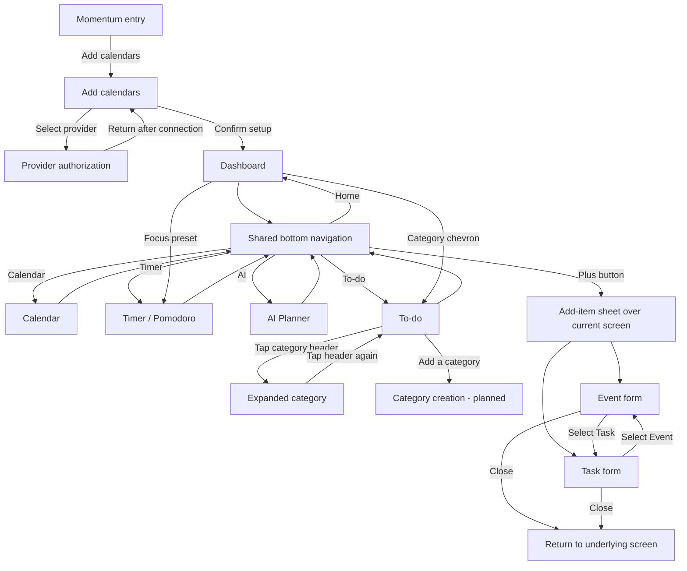

# Mockup and wireframes

Momentum brings calendars, tasks, daily planning, and focused work into one personal productivity app. These mockups define the intended phone interface and navigation. They are design references, not screenshots proving that every feature is implemented.

The mockups are stored in [`assets/mockup/`](../assets/mockup/). Shared colors, typography, spacing, and components are documented in [the design system](03-design-system.md).

## Mockup and screens

### 1. Login and authentication entry

The entry screen introduces Momentum with its logo and wordmark. **Add calendars** opens the calendar connection screen. The mockup does not include username/password fields; provider authentication belongs to the connection flow.

### 1a. Add calendars

Each provider row opens the corresponding authorization or connection flow. The checkmark confirms setup and proceeds to the Dashboard. Google Calendar, Outlook, Canvas, and iOS Calendar are intended integration options; their presence in the mockup does not mean the integrations are implemented.

### 2. Dashboard

The Dashboard summarizes the day: current date/time, the next scheduled item, category pending counts, a To-do preview, and focus presets. Category chevrons are intended to open the corresponding category in To-do. Task checkboxes mark tasks complete. A focus preset is intended to open the Timer with that work/rest duration selected. The bottom dock opens the other main screens, and **+** opens the add-item sheet.

### 3. Calendar

The month and year identify the visible calendar. Left/right chevrons move between months; selecting a date updates the agenda below the grid. Today and the selected date have highlight states. Agenda rows show category, title, time, and estimated duration where applicable. Special events use the accent color, while task checkboxes mark completion. The dock and **+** remain available.

### 4. Timer / Pomodoro

The preset strip offers work/rest combinations. Tapping the circular dial starts or pauses the countdown. The dial displays remaining time and a focus-time total. Due-today tasks stay visible beneath it so the user can choose what to work on and mark completed work. Selecting a preset is intended to configure the countdown and rest period.

### 5. AI Planner

The weekly date strip selects the planning day. The timeline groups scheduled activities into time blocks, displaying category icons, titles, and start/end times. A due-today list provides a second view of outstanding work. Generating a plan and editing its blocks are planned interactions; the mockup does not define their controls or confirmation states yet.

### 6. To-do: collapsed categories

The initial condensed state shows category icons, names, pending counts, and expand chevrons. Tapping a category header expands its items in place. **Add a category** is intended to open category creation; its form is not shown in these mockups.

### 6a. To-do: expanded categories

Expanded categories show task/event lists in rounded surfaces. Tapping the header collapses that category; task checkboxes toggle completion. Rows display titles and scheduling metadata, with accent styling for special events. The list scrolls beneath the floating dock. Collapsed and expanded views are states of the same To-do screen, not separate navigation destinations.

### 7. New event

The add-item sheet overlays the current screen with a blurred backdrop. **Event** selects the event form: title, category, all-day switch, start/end dates and times, and recurrence. **Task** switches to the task form in the same sheet. The active **+** control toggles the sheet closed and returns to the underlying screen. A save/confirm control is not defined in this mockup and must be specified before event creation is complete.

### 7a. New task

The task form contains a title, category picker, and deadline date/time. **Event** switches back to the event form. Closing the sheet returns to the screen where it was opened. New Task and New Event are two states of one add-item sheet, not separate full-screen pages. Save behavior and handling unsaved changes remain design decisions.

## Wireframes

These low-fidelity wireframes reconstruct the five main screens from the supplied mockups. They show content order and reusable regions; they are not the original earlier sketches, which are not present in this repository. Onboarding and the add-item sheet are represented in the flow below and their mockups above.

[Open the wireframes at full size](../assets/mockup/wireframes.svg).

## Screen flow

This diagram describes the intended navigation. The current prototype starts directly on the Dashboard.

## Shared layout and components

| Component | Screens or states | Purpose |
| --- | --- | --- |
| Curved primary-color header | Dashboard, Calendar, Timer, AI Planner, To-do | Identifies the active screen with a centered title |
| Floating navigation dock | All five main screens and the add-item states | Switches destinations and highlights the active icon |
| Floating add button | All five main screens | Opens/closes the Event/Task sheet; uses the accent color while open |
| Task/event row | Dashboard, Calendar, Timer, AI Planner, expanded To-do | Shows status, category, title, schedule, and duration |
| Category icon and pending count | Dashboard and To-do | Identifies grouped work and remaining tasks |
| Category summary surface | Dashboard | Previews the next item in a category |
| Focus preset surface | Dashboard and Timer | Shows work duration and rest duration |
| Calendar date selection | Calendar and AI Planner | Selects the day whose agenda or plan is displayed |
| Event/Task segmented sheet | New Event and New Task | Switches between creation forms above the current screen |

Content should scroll when it exceeds the available height. Card surfaces should wrap their content and padding. Text should use the shared styles in `lib/app_theme.dart`, and spacing should use `AppSpacing` tokens. The floating dock must not prevent the final list item or form field from being reached.

## Prototype coverage

This table distinguishes the intended design from the current source code. It is a source review, not a report of a complete runtime or integration test.

| Area | Current prototype coverage |
| --- | --- |
| Entry and Add Calendars | Mockups only; authentication and provider connection routes are not implemented |
| Dashboard | Date/time, category previews, today's task preview, focus cards, and navigation use sample data; category/preset drill-in actions are not wired |
| Calendar | Month navigation, date selection, and selected-day sample agenda are implemented |
| Timer | A 25-minute countdown supports start/pause; preset selection, automatic work/rest cycling, and a live accumulated focus total are not implemented |
| To-do | Categories expand/collapse, pending counts are displayed, and tasks can be checked in the screen's in-memory data; Add a category is not implemented |
| AI Planner | Header and navigation are present; date strip, timeline, and AI generation are not implemented |
| Add-item sheet | The add button animates an empty popup with a blurred backdrop; Event/Task fields and saving are not implemented |

## States to complete before the final implementation

- **Empty lists:** show an explanatory message and an add action when a category or selected day has no items.
- **Creation forms:** define Save/Confirm, required fields, deadline and end-time validation, and treatment of unsaved changes when switching or closing the sheet.
- **Calendar connections:** provide connection success, cancellation, permission-denied, and retry states; define whether onboarding may be skipped.
- **AI planning:** define loading, failure/retry, sample-plan fallback, and how the user accepts or edits a proposed plan.
- **Timer:** define preset selection, work/rest transitions, countdown completion, and focus-total updates.
- **Accessibility:** retain readable contrast, meaningful icon labels, usable touch targets, and scrolling under larger text settings.

## Changes since the last version

- **October 4, 2026:** replaced the template with all ten mockup embeds, screen/action descriptions, reconstructed wireframes, intended navigation, shared components, and a source-based implementation status. The To-do variants and Event/Task forms are documented as states of their respective screens rather than separate destinations.
