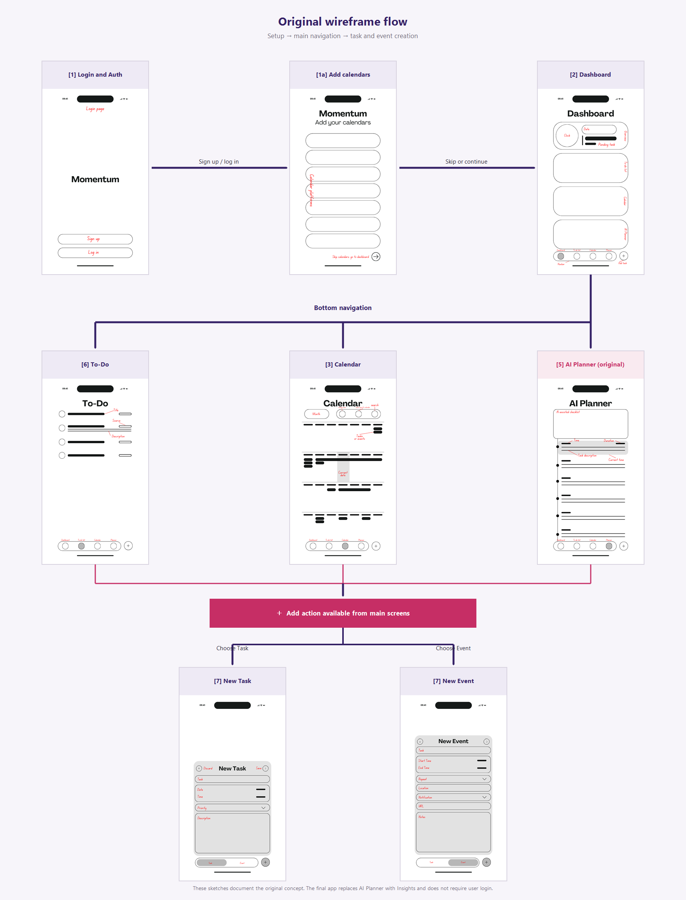

# Mockup and wireframes

The images below preserve the supplied mockups and wireframes. They document
the design direction and early screen flow; the **Screens** section describes
the final app where it differs from those earlier designs.

## Mockup

**[1] Welcome / Get started** — The supplied file is named “Login and Auth,”
but the mockup itself shows the welcome screen and a Get started button. The
final app does not require a planner account.

**[1a] Add calendars** — The mockup shows the optional provider setup step.

**[2] Dashboard**

**[3] Calendar**

**[4] Timer**

**[5] AI Planner — original concept, replaced by Insights in the final app**

**[6] To-Do — expanded and condensed category views**

**[7] New Task and New Event**

## Wireframes

The flow diagram below is rendered from the exact eight supplied wireframe
files. It shows the original proposal flow: account setup, optional calendar
setup, the main screens, and task/event creation. The original Login/Auth and
AI Planner concepts are called out because they are not part of the final app.

**[1] Login and Auth — original wireframe**

**[1a] Add calendars**

**[2] Dashboard**

**[3] Calendar**

**[5] AI Planner — original concept, replaced by Insights in the final app**

**[6] To-Do**

**[7] New Task and New Event**

The supplied wireframes do not include separate Timer or Insights screens. The
final app starts with Welcome, offers optional calendar setup, and then opens
Dashboard. Its main navigation is Dashboard, To-Do, Calendar, Timer, and
Insights; the global add action opens the New Task or New Event form. No
planner login is required, and Insights replaces the original AI Planner.

## Screens

### Welcome and calendar setup

Welcome shows the Momentum brand and a **Get started** action. Continuing opens
Add calendars, where provider connections are optional; skipping or finishing
setup leads to Dashboard. The flow does not create a planner account.

### Dashboard

Dashboard summarizes the current date and time, the next upcoming item,
categories, today's tasks, and focus presets. Selecting a category opens its
items in To-Do. The navigation controls open the other main screens, while the
add action opens the New Task or New Event form.

### To-Do

To-Do groups tasks by category. Category sections can be expanded or collapsed;
tasks can be marked complete, edited, or deleted. The add action opens the task
form, and the main navigation remains available for switching screens.

### Calendar

Calendar displays scheduled tasks and events in month or adjustable week views.
Items appear in chronological order, multi-day events span their dates, and
selecting a date shows that day's agenda. Calendar navigation changes the
visible period; the add action opens the task or event form.

### Timer

Timer lets the user select a task, choose a focus and break duration, and start
or pause a session. Recorded focus time is used by Insights. The screen also
keeps due items available as a reference during a session.

### Insights

Insights summarizes recorded focus time with a weekly chart, a category
distribution, and a longer-term activity heatmap. The week controls move
between periods; this screen reviews completed focus activity and does not
generate an AI schedule.

### Add calendars

Add calendars is available during first-run setup and from the app. It presents
the supported provider connections and their connection status. A user can
connect, sync, or disconnect a provider when its OAuth setup is available;
imports are read-only and are added to the local planner.

### New Task and New Event

The global add action opens a form that switches between Task and Event. A task
can include a title, category, due date and time, estimated duration,
recurrence, and description. An event can include a title, category, start and
end dates and times, an all-day setting, recurrence, location, and notes.
Saving returns to the previous screen, where the item appears in the planner.

The AI Planner mockup and wireframe are retained as records of the original
concept, not as descriptions of a current screen. The final app has no separate
Timer or Insights wireframe.
