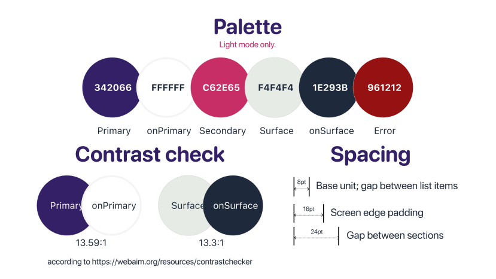
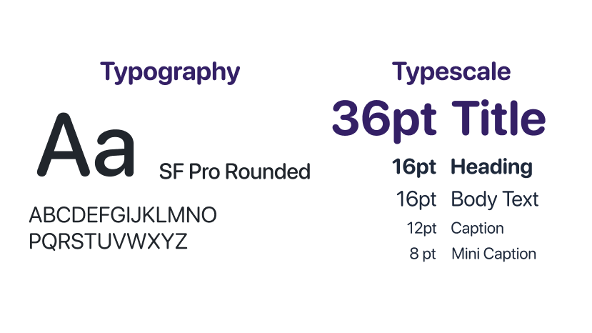

# Design system

## Palette, Spacing

## Type scale

## Components

Reusable widgets currently implemented in the app:

| Component | File | Constructor/s |
| --- | --- | --- |
| AddItemPopup | `lib/widgets/add_item_popup.dart` | `const AddItemPopup({super.key, this.initialItem, this.onSaved, this.onCancel})` |
| AddTaskButton | `lib/widgets/add_task_button.dart` | `const AddTaskButton({super.key, required this.primary, required this.controller, required this.isOpen, required this.onPressed})` |
| BlurredPopupBarrier | `lib/widgets/blurred_dialog.dart` | `const BlurredPopupBarrier({super.key})` |
| FloatingNavigationGroup | `lib/widgets/bottom_navigation_bar.dart` | `const FloatingNavigationGroup({super.key, required this.selectedIndex})` |
| CalendarWidget | `lib/widgets/calendar.dart` | `const CalendarWidget({super.key, this.items = const [], this.onDateSelected, this.initialDate, this.minimumDate, this.compact = false, this.viewMode = CalendarViewMode.fullMonth})` |
| CalendarResizeHandle | `lib/widgets/calendar_resize_handle.dart` | `const CalendarResizeHandle({super.key, required this.mode, required this.fullMonthWeekCount, required this.onModeChanged})` |
| CategoryIcon | `lib/widgets/category_icon_picker.dart` | `const CategoryIcon({super.key, required this.iconName, required this.size, this.color = AppColors.primary, this.fit = BoxFit.contain, this.semanticLabel})` |
| CategoryIconSelector | `lib/widgets/category_icon_picker.dart` | `const CategoryIconSelector({super.key, required this.selectedIconName, required this.onChanged})` |
| CircularIconButton | `lib/widgets/circular_icon_button.dart` | `const CircularIconButton({super.key, required this.backgroundColor, required this.icon, required this.onPressed, required this.tooltip, this.foregroundColor = AppColors.onPrimary, this.iconSize = AppSpacing.addIconSize, this.padding = const EdgeInsets.all(AppSpacing.md), this.duration = Duration.zero})` |
| Clock | `lib/widgets/clock.dart` | `const Clock({super.key, this.onToggleRunning})` |
| CollapsibleCategory | `lib/widgets/collapsible_category.dart` | `const CollapsibleCategory({super.key, required this.title, required this.pendingLabel, required this.iconName, required this.items, this.showPendingCount = true, this.initiallyExpanded = false, this.onDeleteCategory})` |
| DashboardCategoryCard | `lib/widgets/dashboard_category_card.dart` | `const DashboardCategoryCard({super.key, required this.category, required this.nextItem, required this.onTap, this.iconName, this.showPendingCount = true, this.pendingCount})` |
| DayWidget | `lib/widgets/days.dart` | `const DayWidget({super.key, required this.date, required this.isSelected, this.minimumDate, this.onSelected, this.compact = false})` |
| EstimatedDurationPicker | `lib/widgets/estimated_duration_picker.dart` | `const EstimatedDurationPicker({super.key, required this.value, required this.onChanged})` |
| FocusPreset | `lib/widgets/focus_preset.dart` | `const FocusPreset({super.key, this.workMinutes = 30, this.breakMinutes = 5, this.margin, this.onPressed})` |
| PillActionButton | `lib/widgets/pill_action_button.dart` | `const PillActionButton({super.key, required this.label, required this.onPressed, this.leadingIcon, this.trailingIcon, this.foregroundColor = AppColors.primary, this.outlineColor = AppColors.surface})` |
| PlannerLoadGate | `lib/widgets/planner_load_gate.dart` | `const PlannerLoadGate({super.key, required this.child})` |
| PrimaryAppBar | `lib/widgets/primary_app_bar.dart` | `const PrimaryAppBar({super.key, required this.destination, this.isBlurred = false, this.actions, this.automaticallyImplyLeading = true})`; `const PrimaryAppBar.withTitle({super.key, required this.title, this.isBlurred = false, this.actions, this.automaticallyImplyLeading = true})` |
| ResponsiveAppViewport | `lib/widgets/responsive_app_viewport.dart` | `const ResponsiveAppViewport({super.key, required this.child})` |
| Selector | `lib/widgets/selector.dart` | `const Selector({super.key, required this.options, required this.selectedValue, required this.placeholder, required this.onChanged, this.alignment = AlignmentDirectional.centerStart, this.isExpanded = false, this.contentColor = AppColors.primary})` |
| SwipeToRevealDelete | `lib/widgets/swipe_to_reveal_delete.dart` | `const SwipeToRevealDelete({super.key, required this.child, required this.onDelete, this.deleteLabel = 'Delete item', this.backgroundColor = AppColors.surface, this.deleteCircleScale = 1})` |
| TaskListContainer | `lib/widgets/task_list_container.dart` | `const TaskListContainer({super.key, required this.items, this.categoryIconName, this.categoryIconForItem, this.maxVisibleItems = _maxVisibleTasks, this.appearanceType = TaskAppearanceType.withoutCategoryIcon, this.onChecked, this.onItemTap, this.onDelete})` |
| TaskWidget | `lib/widgets/task_widget.dart` | `const TaskWidget({super.key, required this.task, this.categoryIconName, this.appearanceType = TaskAppearanceType.checkable, this.onChecked, this.onTap})`; `const TaskWidget.event({super.key, required this.event, this.categoryIconName, this.onTap})` |
| WeekWidget | `lib/widgets/week.dart` | `const WeekWidget({super.key, required this.days, required this.selectedDay, required this.items, required this.onDaySelected, this.minimumDate, this.compact = false, this.showTaskIndicators = true})` |

## Changes since the last version

The remaining components from the midterm version retain similar functions in the final app, although some may have been renamed. Only substantial changes are listed below.

- **Calendar:** The midterm plan used a toolbar and separate event chips. The final app builds an integrated calendar grid with titled bars that span multiple days, compact views, and resizing. This changed the calendar structure and how scheduled items appear across the grid.
- **Add and edit flow:** The midterm plan used separate modal, task/event toggle, and form components. The final app combines task and event creation and editing in one `AddItemPopup` with shared selectors and pickers, changing the flow from separate form pieces to one unified editor.
