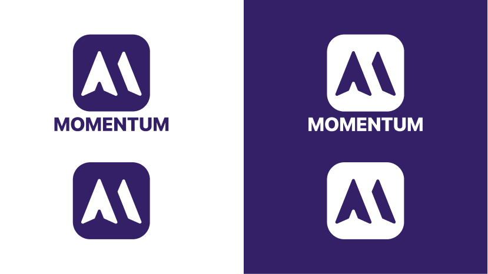

# Design system





```dart
final scheme = ColorScheme.light(
  primary: const Color(0xFF342066),     // your primary
  onPrimary: const Color(0xFFFFFFFF),
  secondary: const Color(0xFFC62E65),
  surface: const Color(0xFFF4F4F4),
  onSurface: const Color(0xFF1E293B),
  error: const Color(0xFF961212),
);
```

| Role | Hex | Used for |
| --- | --- | --- |
| primary | 342066 | main buttons, active states |
| onPrimary | FFFFFF | text and icons on primary |
| secondary | C62E65 | highlights, secondary actions |
| surface | F4F4F4 | cards, sheets, dialogs |
| onSurface | 1E293B | body text |
| error | 961212 | validation, destructive actions |

Contrast check:
Primary & onPrimary: 13.59:1
Surface & onSurface: 13.3:1

Light only, for now.

## Step B: The type scale, as a TextTheme (10 min)

```dart
textTheme: const TextTheme(
  headlineLarge: TextStyle(
    fontFamily: 'SFProRounded',
    fontSize: 36,
    fontWeight: FontWeight.bold,
  ),
  titleMedium: TextStyle(
    fontFamily: 'SFProRounded',
    fontSize: 16,
    fontWeight: FontWeight.bold,
  ),
  bodyMedium: TextStyle(
    fontFamily: 'SFProRounded',
    fontSize: 16,
    fontWeight: FontWeight.normal,
  ),
  bodySmall: TextStyle(
    fontFamily: 'SFProRounded',
    fontSize: 12,
    fontWeight: FontWeight.normal,
  ),
  labelSmall: TextStyle(
    fontFamily: 'SFProRounded',
    fontSize: 8,
    fontWeight: FontWeight.normal,
  ),
),
```

| Your style | Flutter slot | Size | Weight | Used for |
| --- | --- | --- | --- | --- |
| Headline | `headlineLarge` | 36pt | Bold | app wordmark, splash screen |
| Titles | `titleMedium` | 16pt | Bold | screen titles, section headers |
| Body Text | `bodyMedium` | 16pt | Regular | list item text, fields, other normal content |
| Caption | `bodySmall` | 12pt | Regular | timestamps, hints, secondary metadata |
| Mini Caption| `labelSmall` | 8pt | Regular | tiny inline tags |

Then use them by name in your widgets, never by literal size:

```dart
Text('HAUDEX', style: Theme.of(context).textTheme.headlineLarge)
```

Since SF Pro is the native Apple font, it is not available on Google Fonts. As such, it will be imported as local assets and will be registered in pubspec.yaml.

```
fonts:
  - family: SFProRounded
    fonts:
      - asset: assets/fonts/SF-Pro-Rounded-Regular.ttf
      - asset: assets/fonts/SF-Pro-Rounded-Bold.ttf
        weight: 700
```

## Step C: Spacing, as constants (5 min)

```dart
class AppSpacing {
  static const double base = 8;

  static const double xs = base * 0.5;   // 4
  static const double sm = base;         // 8
  static const double md = base * 2;     // 16
  static const double lg = base * 3;     // 24

  static const double screenEdgePadding = md;  // 16 pt
  static const double listItemGap = sm;         // 8 pt
  static const double sectionGap = lg;          // 24 pt
}
```

- Base unit: 8 pt
- Screen edge padding: 16 pt
- Gap between list items: 8 pt
- Gap between sections: 24 pt

## Changes since the last version
